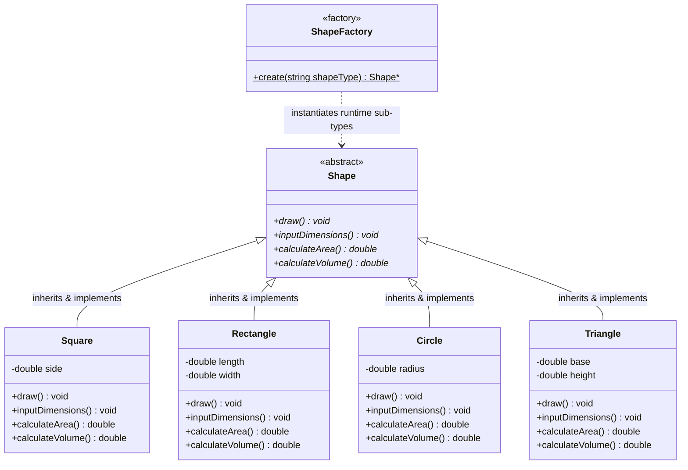

# 🏛️ C++ Design Patterns & Object-Oriented Architectural Foundations

<p align="center">
  
  
  
  
  
</p>

---

## 🌟 Architectural Overview

**`CPP-Design-Patterns-Foundations`** is a clean, modern C++ architectural framework implementing the **Gang of Four (GoF) Factory Method Design Pattern** alongside core **SOLID principles**. 

The system demonstrates dynamic runtime object creation, abstract virtual polymorphism, dimensional mathematical modeling (area and volume computations), and clean memory lifecycle management across geometric domain models.

---

## 🏗️ Class Hierarchy & Design Architecture

The framework leverages dynamic polymorphism where the client code interacts exclusively with the abstract base class `Shape`, decoupling object instantiation from domain business logic through `ShapeFactory`.



---

## 📐 SOLID Principles Implementation Matrix

| Principle | Architectural Implementation in Codebase |
|:---|:---|
| **S — Single Responsibility (SRP)** | `ShapeFactory` is exclusively responsible for runtime string-to-object parsing and dynamic memory allocation. Geometric classes only encapsulate their mathematical contracts and dimension state. |
| **O — Open / Closed (OCP)** | New geometric types (e.g., `Pentagon`, `Cylinder`, `Sphere`) can be introduced by subclassing `Shape` without altering the client consumer or existing shape definitions. |
| **L — Liskov Substitution (LSP)** | Every concrete subclass (`Square`, `Rectangle`, `Circle`, `Triangle`) can be transparently substituted anywhere a `Shape*` pointer is consumed without breaking program correctness. |
| **I — Interface Segregation (ISP)** | `Shape` defines a focused, cohesive contract for dimensional computation and rendering. Abstract methods are strictly essential to 2D/3D geometric entities. |
| **D — Dependency Inversion (DIP)** | The `main()` execution client depends purely on the abstract `Shape` interface, rather than concrete instantiations. |

---

## 📂 Source Code Catalog

```text
├── Shape.cpp          # Abstract Base Class defining pure virtual interfaces
├── ShapeFactory.cpp   # Factory Method implementation with Enum type-safety
├── Enum.cpp           # String-to-enumeration parser for safe runtime dispatch
├── Square.cpp         # Concrete Square implementation (Area = s², Volume = s³)
├── Rectangle.cpp      # Concrete Rectangle implementation (Area = l×w, Volume = l×w×h)
├── Circle.cpp         # Concrete Circle implementation (Area = πr², Volume = 4/3 πr³)
├── Triangle.cpp       # Concrete Triangle implementation (Area = 0.5×b×h)
├── Area.cpp           # Global mathematical area utility routines
├── Volume.cpp         # Global mathematical volume utility routines
├── Input.cpp          # Standardized CLI dimension stream reader
├── Main.cpp           # High-level entry point & polymorphic consumer
└── .gitignore         # Build artifacts, object files, and IDE ignore rules
```

---

## ⚡ Build & Execution Instructions

Compile and run using any modern C++ compiler (`g++` or `clang++` supporting C++11/C++14/C++17):

### Using `clang++` (macOS):
```bash
clang++ -std=c++17 Main.cpp -o shape_runner
./shape_runner
```

### Using `g++` (Linux):
```bash
g++ -std=c++17 Main.cpp -o shape_runner
./shape_runner
```

### Sample Interactive Session:
```text
Enter a Shape
Circle
Drawing Circle...
Enter Radius: 5
Area : 78.5398
Volume : 523.599
```

---

## 🔒 Memory Management & Safety

1. **Virtual Destructor Contract:** Guarantees proper polymorphic object teardown when deleting via base `Shape*` pointers, preventing resource leaks.
2. **Explicit Teardown:** Dynamically allocated heap memory via `ShapeFactory::create()` is explicitly cleared using `delete shapeHandler;` at the end of the consumer scope.
3. **Null Pointer Guard:** Handlers validate `if (shapeHandler)` prior to invoking member functions to prevent null dereferencing.

---

## 👤 Author & Architecture Credit

- **Principal Engineer:** [**Muhammad Ali**](https://github.com/itismemuhammadali)
- **Primary GitHub:** [@ItIsMeMuhammadAli](https://github.com/itismemuhammadali)
- **Contact:** `itismemuhammadali@gmail.com`
